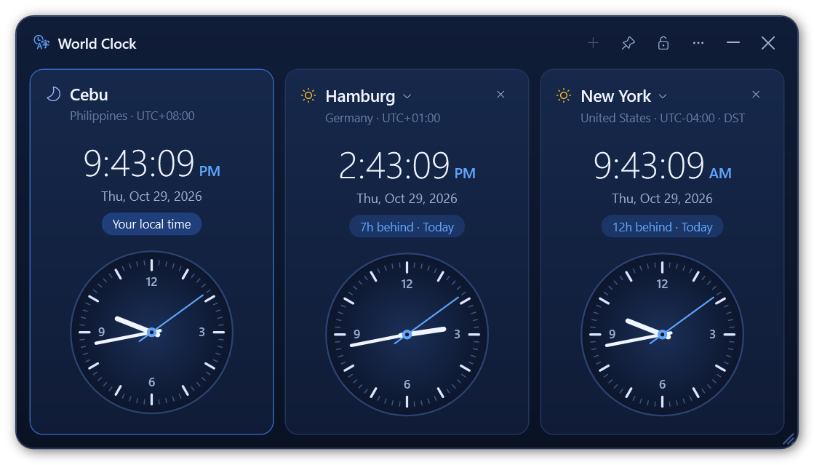
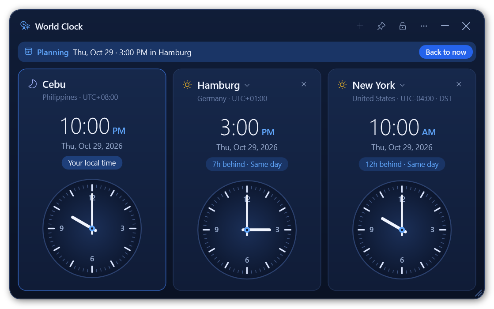

# World Clock

A small, offline desktop clock for Windows that shows your local time next to up to two
teammates' time zones, each with a digital and an analog clock. It can shrink to a single
draggable line when you just want the times.






## Run it

```powershell
git clone https://github.com/bernardjosephgtrz/world-clock.git
.\world-clock\dist\WorldClock.exe
```

That's it: a single ~100 KB exe, no installer, no admin rights, no internet. It runs on
Windows 10/11 using the .NET Framework 4.8 that ships with Windows.

## Features

- **Up to 3 clocks side by side.** The first is always Cebu, Philippines (UTC+8).
  Click a city name to change it, `+` to add one, `×` to remove one.
- **Searchable time zone picker.** Type a city, country, Windows zone name or `utc+1`.
  Arrow keys + Enter, or click.
- **Digital on top, analog below**, 12-hour with seconds, date, and the difference from
  you, e.g. `6h behind · Today` / `Yesterday` / `Tomorrow`. Sun/moon icon shows day or night there.
- **Plan a meeting time.** Someone says "3 pm my time"? Click the time on their clock and type
  `3pm` (or `15:00`, `3:30 pm`), then Enter. Every clock jumps to that moment, so you see it in your
  own time straight away. Scroll over a time to move it 15 minutes (Shift + scroll: 1 hour), or over
  the date to move a day. **Back to now** or Esc returns to the live time.
- **Daylight saving time is automatic**, using the time zone rules built into Windows.
- **Always on top** or a normal window that other apps can cover: pin button, right-click
  menu, or tray icon.
- **Place it anywhere:** drag it, lock it, or snap it to a corner / the center / the next
  monitor. It remembers where it was. If a monitor disappears (laptop undocked) it comes
  back to your main screen and returns to its spot when the monitor is reconnected.
- **Resizable:** drag the bottom-right grip, Ctrl + mouse wheel, Ctrl `+` / `−` / `0`,
  or right-click → Size (60% – 200%).
- **One-line view:** the `—` button shrinks it to a strip of digital clocks you can drag
  anywhere (it has its own remembered spot). Double-click it or press the expand button
  to go back.
- **System tray:** `×` hides it to the tray. Click the tray icon to bring it back;
  right-click → Exit to quit.

Settings live in `%APPDATA%\WorldClock\settings.ini`. Delete that file to reset.

## Build from source

No SDK needed; the build uses the C# compiler included with Windows.

```powershell
.\build.ps1          # builds dist\WorldClock.exe
.\build.ps1 -Test    # also builds and runs the unit tests
```

If PowerShell blocks the script, run it with
`powershell -NoProfile -ExecutionPolicy Bypass -File .\build.ps1 -Test`.
Commit the rebuilt `dist\WorldClock.exe` together with source changes so a fresh clone
always runs the latest version.

`tools\screenshots.ps1` regenerates the images in `docs\` straight from the UI.

## Project layout

```
src/            app source (WPF, C# 5 / .NET Framework 4.8)
tests/          unit tests for time math, DST, planning, search and settings
dist/           ready-to-run WorldClock.exe
docs/           README screenshots
tools/          screenshot generator
build.ps1       build + test script
app.manifest    DPI awareness, runs without admin
```

## License

MIT
